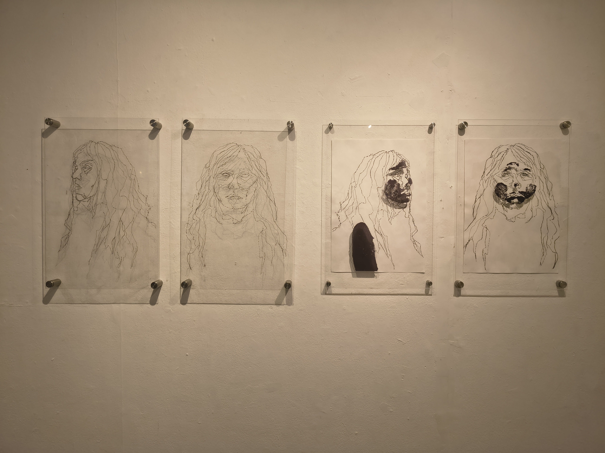
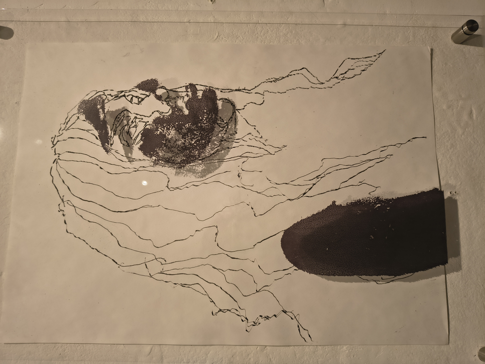
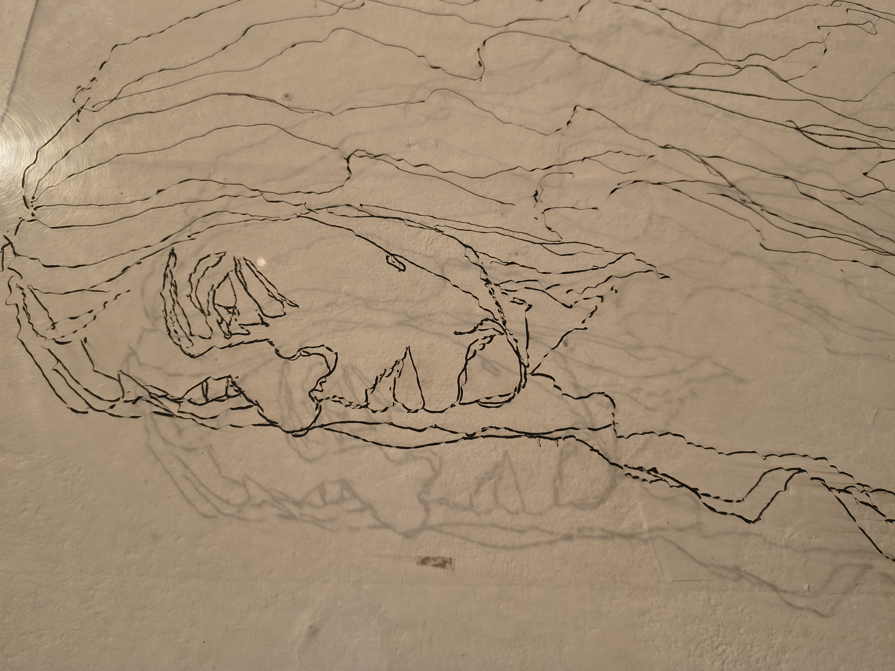
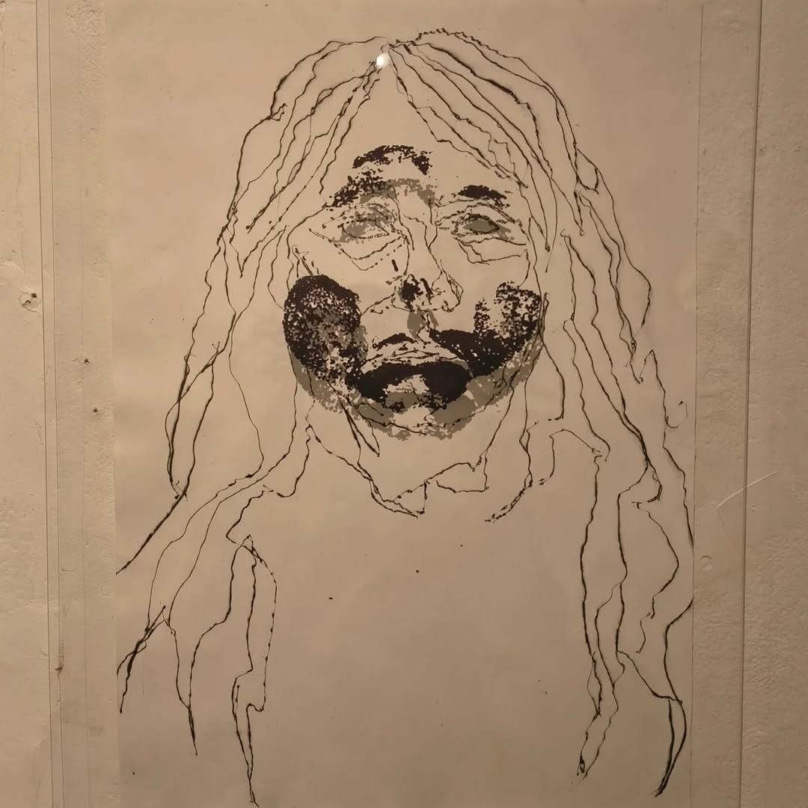
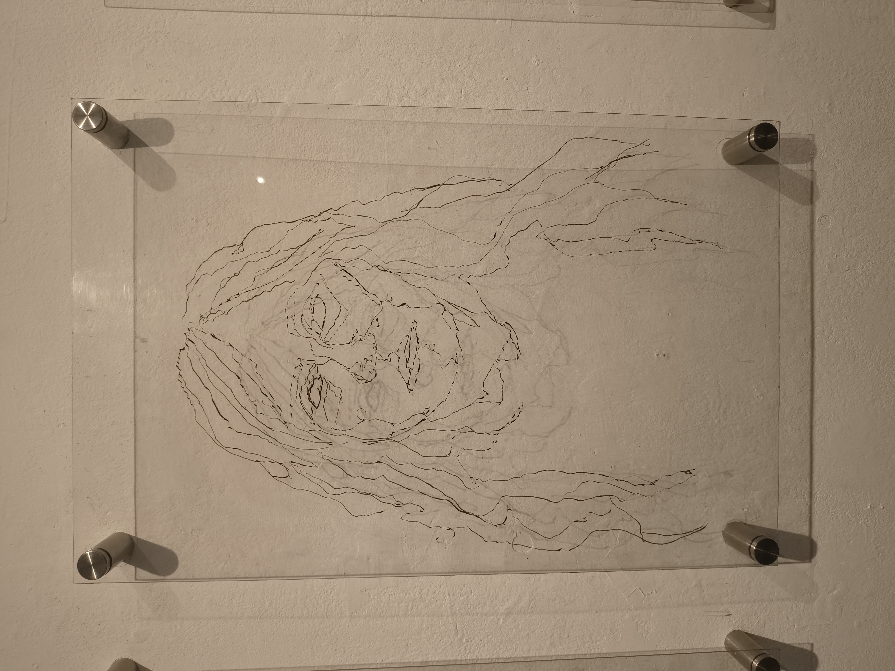

# Multimedial
## Exploración creativa de arte, tecnología y medios digitales interactivos.

### index
<h2><font color="white">Unidad I. <a href="#unidad-i--hiperviculo-" >Hipervínculo</a></font></h2><br>
1. EJERCICIO 1, SEMANA 1 <br> 
2. MI PRIMERA PAGINA WEB <br> 
3. LINKS DE PAGINA WEB <br> 


## Unidad II. <a href="#programación-visual-creativa-basada-en-nodos" style=";">Programación visual creativa basada en nodos</a> <br>
1. INTRO TOUCH DESIGNER <br>
2. EJERCICIOS <br>
3. EXPERIMENTACION PROYECTO FINAL <br>
##### Nube de puntos con Pop basada en imágenes, Lsystem, Mapping básico 


## <span style="color: pink;">Unidad I. Hipervicunlo</span> 
## <span style="color: red;">1. Ejercicio 1 semana 1:</span>
``` html
<!DOCTYPE html>
<!-- Indica al navegador que este documento usa HTML5 -->

<html>
<!-- Inicio del documento HTML -->

<head>
<!-- Sección donde van metadatos, título y estilos -->

<meta charset="UTF-8">
<!-- Define la codificación de caracteres para que se vean bien tildes y símbolos -->

<title>Multimedial</title>
<!-- Título de la página que aparece en la pestaña del navegador -->

<style>
/* Aquí comienza la sección de estilos CSS que define la apariencia visual */

body{
/* "body" se refiere a todo el contenido visible de la página */

  background-color: white;
  /* Define que el fondo de toda la página sea blanco */

  color: black;
  /* Define que el color del texto sea negro */

  margin: 0;
  /* Elimina los márgenes que los navegadores agregan por defecto */

  height: 100vh;
  /* Hace que el alto del cuerpo sea igual al 100% de la altura de la pantalla */

  display: flex;
  /* Activa el sistema Flexbox para organizar y centrar elementos */

  justify-content: center;
  /* Centra el contenido horizontalmente */

  align-items: center;
  /* Centra el contenido verticalmente */

  font-family: Arial, sans-serif;
  /* Define la tipografía del texto */

  font-size: 60px;
  /* Define el tamaño grande del texto */

}
/* Fin de las reglas de estilo del body */

</style>
<!-- Fin de la sección de estilos -->

</head>
<!-- Fin de la sección head -->

<body>
<!-- Inicio del contenido visible de la página -->

MULTIMEDIAL
<!-- Texto que aparece en el centro de la pantalla -->

</body>
<!-- Fin del contenido visible -->

</html>
<!-- Fin del documento HTML -->
```

## <span style="color: red;">2. Mi primera pagina web:</span>
#### Index:
```html
<!DOCTYPE html>
<!-- Indica al navegador que este documento usa HTML5 -->

<html>
<!-- Inicio del documento HTML -->

<head>
<!-- Sección donde van metadatos, título y estilos -->

<meta charset="UTF-8">
<!-- Define la codificación de caracteres para que se vean bien tildes y símbolos -->

<title>Jacqueline Peralta</title>
<!-- Título de la página que aparece en la pestaña del navegador -->

<style>
/* Aquí comienza la sección de estilos CSS que define la apariencia visual */

body{
/* "body" se refiere a todo el contenido visible de la página */
background-image: url(img/IMG_20251203_181110715.jpg);
background-size: cover;
  background-color: rgb(186, 178, 130);
  color: black;
  margin: 0;
  font-family: 'Times New Roman', Times, serif;
  text-align: center;
  padding-top: 50px;
}
.header{
  position: fixed;
  top: 0;
  left: 0;
  width: 100%;
  display: flex;
  flex-direction: column;
  align-items: center;
  padding: 20px 0;
  background: #cfbfa1;
  backdrop-filter: blur(6px);
  z-index: 10;
}
.header h1{
  margin: 0;
  font-size: 60px;
}
.header nav{
  margin-top: 10px;
}
.header a{
  margin: 0 15px;
  font-size: 20px;
  color: black;
  text-decoration: none;
}
.header a:hover{
  opacity: 0.7;
}
</style>
</head>

<body>
  <div class="header">
    <h1>Jacqueline Peralta</h1>
    <nav>
      <a href="obra.html">Obra</a>
      <a>|</a>
      <a href="contacto.html">Contacto</a>
      
    </nav>
  </div>
/* Fin de las reglas de estilo d }

        /* Imagen */
        .bloque img {
            width: 50%;
            height: auto;
            margin: 30px 0;
        }el body */

</style>
<!-- Fin de la sección de estilos -->

</head>
<!-- Fin de la sección head -->

<body>
<!-- Inicio del contenido visible de la pagina -->

     Jacqueline Peralta
<!-- Texto que aparece en el centro de la pantalla -->

<a href="obra.html">ir a obra</a>
<a href="contacto.html">contacto</a>


</body>
<!-- Fin del contenido visible -->

```


### Ejercicio extra: insertar imagenes en una página.

##### Sintaxis básica:
```html

```

## <span style="color: red;">3. links de pagina web  </span>
Objetivo: pensar en estructura + narrativa.


obra.html
contacto.html


obras.html
```html
<!DOCTYPE html>
<html>
<head>
<title>Página 2</title>
</head>
<meta charset="UTF-8">
    <title>Estructura con Divisiones</title>

    <style>
        /* Estilo general del cuerpo */
        body {
            font-family: 'Times New Roman', serif;
            background-color: #b9aa8e;
            margin: 0;
            background-image: url(img/IMG_20251203_181110715.jpg);
background-size: cover;
        }

        /* Contenedor principal */
        .contenedor {
            width: 50%;
            margin: auto;
        }

        /* Sección o bloque */
        .bloque {
            background-color:  #cfbfa1;
            margin: 20px 0;
            padding: 20px;
            border-radius: 10px;
            text-align: center;
        }

        /* Imagen */
        .bloque img {
            width: 50%;
            height: auto;
            margin: 30px 0;
        }
  
        /* Encabezado */
        .bloque h2 {
            margin-top: 10px;
        }

        /* Texto */
        .bloque p {
            line-height: 1.5;
        }
          .bloque1 {
            background-color:  #cfbfa1;
            margin: 20px 0;
            padding: 20px;
            border-radius: 10px;
            text-align: center;
        }

        /* Imagen */
        .bloque1 img {
            width: 80%;
            height: auto;
            margin: 30px 0;
        }
  
        /* Encabezado */
        .bloque1 h2 {
            margin-top: 10px;
        }

        /* Texto */
        .bloque1 p {
            line-height: 1.5;
        }
       
    </style>
</head>

<body>

    <!-- Contenedor principal -->
    <div class="contenedor">

        <!-- BLOQUE 1 -->
        <div class="bloque1">
            
          
            <h2>Colateral</h2>
            <p>
             Serie de 4 acrilicos montados a 5cm del muro, 2 acrilicos tallados (calcografia) y 2 impresos (serigrafia) acompañados de 2 impresiones.
            </p>
        </div>

        <!-- BLOQUE 2 -->
        <div class="bloque">
            
            <h2>Huella y linea perfil</h2>
            <p>
                Acrilico impreso en serigrafia sobre impresion calcografia.
                40 x 50 cm. 2025.
            </p>
        </div>

        <!-- BLOQUE 3 -->
        <div class="bloque">
            
            <h2>Linea y sombra perfil</h2>
            <p>
                Acrilico tallado con dremel.
                40 x 50 cm. 2025.
            </p>
        </div>
        <!-- BLOQUE 4 -->
        <div class="bloque">
            
            <h2>Huella y linea frente</h2>
            <p>
                 Acrilico impreso en serigrafia sobre impresion calcografia.
                40 x 50 cm. 2025.
            </p>
       
        </div>
         <!-- BLOQUE 5 -->
        <div class="bloque">
            
            <h2>Linea y sombra frente</h2>
            <p>
                Acrilico tallado con dremel.
                40 x 50 cm. 2025.
            </p>
        </div>
    </div>

</body>
</html>
<body>

<h1>Obra "Colateral"</h1>
<h1></h1><h1></h1></body>


</a>

<h3></h3>

<a href="index.html">Volver a la pagina principal</a>

</body>
</html>

```

##### contacto.html:
```html
<!DOCTYPE html>
<html>
<head>
<title>Contacto</title>
</head>

<body>

<h1>Contacto</h1>


<p>jperaltao@uft.edu</p>

<a href="index.html">Inicio</a><br>
<a href="obra.html">Obra</a>

</body>
</html>
```

* Pagina Web: [¡Descubre mi pagina web!](https://jake11401.github.io/Multimedial/w/index.html)


##  <span style="color: pink;">UNIDAD II. Programación visual creativa basada en nodos</span> 

###  <span style="color: red;"> 1. Intro Touch Designer </span>

#### <span style="color: red;"> Ejercicio 1: </span> POINT (interacción)
##### Objetivo: Que los elementos reaccionen al mouse

##### Instrucciones:
- Crear un botón o bloque
- Cambiar su color cuando el mouse pasa encima
- Agregar una transición suave

##### VISUAL:

#### <span style="color: red;"> Ejercicio 2: </span> LSYSTEM

##### VISUAL:

#### <span style="color: red;"> Ejercicio 3: </span>  MAPPING

##### VISUAL:

### <span style="color: red;"> 3. Experimentacion Proyecto final </span> 
##### VISUAL:


